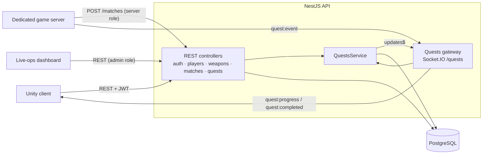

# Game Backend · NestJS

[](https://github.com/arthurpvilar/game-backend-nestjs/actions/workflows/ci.yml)


A reference backend for a multiplayer game: **player accounts, match history and stats, a live-ops weapon
catalog, and real-time quests pushed over WebSockets**.

It distills the architecture I built for a shipped Unity 6 + FishNet multiplayer game into a small,
fully tested codebase: no client code, just the patterns.

## Highlights

- **Server-authoritative progression.** Only the dedicated game server can report match results or quest
  events. Game clients receive progress, they never grant it to themselves.
- **Real-time quests.** Progress and completions are pushed to the player's socket the moment they happen
  (Socket.IO, JWT-authenticated handshake, one room per player).
- **Live-ops without a client build.** Admins rebalance weapons (damage, fire rate, magazine, reload)
  through the API; the client downloads the catalog at boot.
- **Safe by construction.** Match results are written in a single transaction; quest rewards are
  idempotent (XP is awarded exactly once, even if an event is replayed).
- **Runs anywhere.** The same entities work on PostgreSQL and on in-memory SQLite, so CI runs the full
  end-to-end suite without a database service, and a separate job smoke-tests the Docker image on Postgres.

## Architecture



| Module | Responsibility |
|---|---|
| `auth` | Sign-up and login (bcrypt + JWT). Roles: `player`, `admin`, `server`. |
| `players` | Profile, XP, aggregated stats (matches, wins, kills, deaths, K/D). |
| `weapons` | Public live catalog plus admin-only create and rebalance. |
| `matches` | Server-reported results, per-player history; feeds the quest system after commit. |
| `quests` | Quest definitions, per-player progress, and the real-time gateway. |

## API

Interactive docs (Swagger) are served at **`/docs`** once the app is running.

| Method | Route | Who | Description |
|---|---|---|---|
| `POST` | `/auth/register` | anyone | Create a player account, returns a JWT |
| `POST` | `/auth/login` | anyone | Exchange credentials for a JWT |
| `GET` | `/players/me` | player | Current profile and XP |
| `GET` | `/players/:id/stats` | player | Matches, wins, kills, deaths, K/D |
| `GET` | `/players/:id/matches?limit=20` | player | Match history, newest first |
| `GET` | `/weapons` | anyone | Live catalog (enabled weapons) |
| `GET` | `/weapons/all` | admin | Full catalog, including disabled weapons |
| `POST` | `/weapons` | admin | Add a weapon |
| `PATCH` | `/weapons/:slug` | admin | Rebalance or disable a weapon |
| `POST` | `/matches` | server, admin | Report a finished match |
| `GET` | `/quests/me` | player | Active quests with your progress |
| `POST` | `/quests` | admin | Create a quest |
| `GET` | `/health` | anyone | Liveness and database check |

### Real-time quests (Socket.IO, namespace `/quests`)

Connect with the JWT in the handshake: `io(url + '/quests', { auth: { token } })`.
Invalid tokens are disconnected immediately.

| Direction | Event | Payload |
|---|---|---|
| server → player | `quest:progress` | `{ code, title, target, progress, completed, rewardXp, justCompleted }` |
| server → player | `quest:completed` | same as above, sent once when the target is reached |
| game server → API | `quest:event` (with ack) | `{ playerId, type: 'kill' \| 'match_played' \| 'match_won', amount? }` |

Reporting a match through `POST /matches` emits `match_played`, `kill` and `match_won` events
automatically; `quest:event` is for live progress during a match.

### Calling it from Unity

```csharp
[Serializable] class Weapon { public string slug; public int damage; public float fireRate; public int magazineSize; public float reloadTime; }
[Serializable] class WeaponList { public Weapon[] items; }

IEnumerator LoadWeapons(string baseUrl)
{
    using var request = UnityWebRequest.Get($"{baseUrl}/weapons");
    yield return request.SendWebRequest();
    if (request.result != UnityWebRequest.Result.Success) yield break;

    // JsonUtility can't parse a top-level array, so wrap it.
    var catalog = JsonUtility.FromJson<WeaponList>($"{{\"items\":{request.downloadHandler.text}}}");
    foreach (var weapon in catalog.items) WeaponRegistry.Apply(weapon);
}
```

For the socket, any Socket.IO v4 client for Unity works (for example `SocketIOClient` / `SocketIOUnity`),
passing `{ token }` as the auth payload.

## Run it

**With Docker** (API + PostgreSQL):

```bash
docker compose up --build
```

```bash
docker compose exec api node dist/seed.js
```

The seed creates an `admin` and a `game-server` account (passwords from `SEED_ADMIN_PASSWORD` and
`SEED_SERVER_PASSWORD`), three weapons and three quests. Then open http://localhost:3000/docs.

**Locally:**

```bash
npm ci
cp .env.example .env
npm run start:dev
```

## Tests

```bash
npm test          # unit tests (quest progression rules)
npm run test:e2e  # full app: auth, roles, live-ops, match reporting, stats and the WebSocket flow
npm run lint
```

Both suites boot against in-memory SQLite, so they need no external services.

## Project structure

```
src/
├── auth/        sign-up, login, JWT
├── common/      AuthGuard, @Roles, @CurrentUser
├── players/     profile, XP, stats
├── weapons/     live-ops catalog
├── matches/     match reporting and history
├── quests/      quest rules, progress, Socket.IO gateway
├── health/      liveness check
├── setup.ts     validation, CORS, Swagger (shared with the e2e tests)
└── seed.ts      idempotent starter data
test/            end-to-end suite
```

## What I'd add for production

- TypeORM migrations instead of `synchronize`.
- Refresh tokens and rate limiting on the auth routes.
- The Socket.IO Redis adapter to scale the gateway horizontally.
- Row-level locking (or a single atomic `UPDATE`) for quest progress under heavy concurrent writes.

## License

[MIT](LICENSE) © Arthur Padilha
